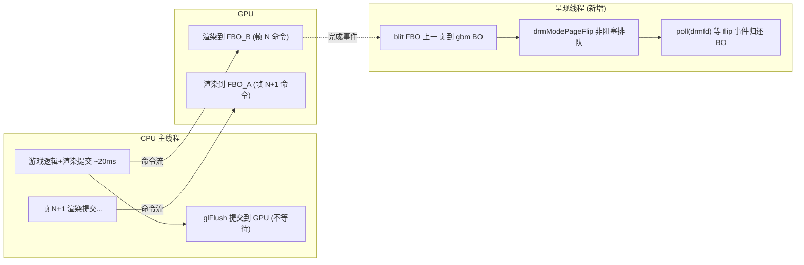
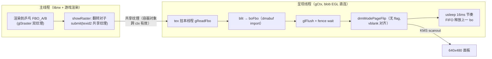
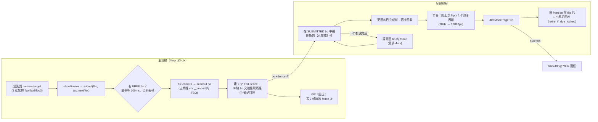

# 09 - R36S 三缓冲呈现方案设计（解开 swap 的 fence 串行）

> 目标平台：R36S（RK3326 / 四核 Cortex-A35 / Mali-G31 MP1 Bifrost r0p0 / Linux 4.4 KMSDRM）
> （硬件实测：CPU part 0xd04=A35，GPU "Mali-G31 1 cores r0p0 0x7093"，blob r13p0；
> 设备树 compatible 写 malit602 是 BSP 模板串未更新，以 kbase 上报的 G31 为准）
> 前置：docs/08 性能深挖。结论：fps 28-33 的天花板是双缓冲 fence 串行——
> `eglSwapBuffers` 内 `poll(/dev/mali0)` 等 GPU 释放 buffer ~10ms，
> CPU 提交（~20ms）与 GPU 排空（~10ms）被迫串行。
> 参考实现：re3 主仓 `src/skel/gbm/` + `docs/16-异步呈现流水线设计.md`
> （Pi Zero 2 W 双 FBO 乒乓，gpu 等待 3.46→0.02ms，+10fps）。

---

## 1. 现状时序（问题的本质）

```
当前（SDL KMSDRM + Mali blob 双缓冲）:

帧N:   [CPU 提交 20ms]──[swap: poll(mali0) 等 GPU 释放 buffer ~10ms]
                          └── GPU 在渲染帧N-1，没渲完就不能复用 buffer
帧时 = CPU + GPU串行等待 ≈ 30-35ms（fps 28-33）
```

关键事实链（全部实测，见 docs/08 §2/§7）：

1. `VSync=0` 生效（`[swapinterval] want=0`，仅 4 次菜单切换）——但没用
2. swap 的等待 = `poll(/dev/mali0, POLLIN, -1)` ≈10ms（LD_PRELOAD 钩 `poll()` 实测，fd 已确认是 kbase 设备）
3. 这是**双缓冲的 buffer 复用 fence 语义**：blob EGL 在 `eglCreateWindowSurface` 内部分配 buffer，无任何配置入口（环境变量/SDL 选项/gbm 接口都翻过）
4. GPU 真实整帧执行 ≈10ms（timer query 只测到提交段 0.3ms，fence 等待才是整帧栅格化）
5. CPU 提交 20ms 里一半是 blob CMAR 队列固定成本（perf：libmali self 48.6%）

**本质**：CPU 和 GPU 都只半满，被双缓冲 fence 强制串行。三缓冲让
"渲染中的 buffer / 待扫描的 buffer / CPU 正在写的 buffer"三个角色分开，
CPU 永远有 buffer 可写 → CPU‖GPU 真并行。

## 2. 为什么不能"直接开三缓冲"

| 尝试路径 | 结论 |
|---|---|
| SDL triple buffer 选项 | ❌ 不存在（SDL 2.0.32 strings 全翻） |
| Mali blob 环境变量 | ❌ 无 buffer count 配置项 |
| gbm_surface 参数 | ❌ buffer 数由 blob EGL 内部分配，不暴露 |
| LD_PRELOAD 钩 eglSwapBuffers | ❌ SDL KMSDRM 硬编码 `dlopen("libmali-bifrost-g31-rxp0-gbm.so")` + dlsym 直取指针，绕过拦截 |

**唯一出路**：不再让 blob EGL 拥有窗口 surface——改为**离屏渲染 + 自管呈现链**
（re3 GBM 方案同款思路，但呈现端不同：Pi 是 SPI 小屏，我们是 KMS 大屏）。

## 3. 方案设计

### 3.1 总体架构



**三个解耦点**（对应三个"缓冲"角色）：

1. **渲染目标**：主相机挂双 FBO 乒乓（`fbo_A/fbo_B`），CPU 帧间交替提交，
   永不等 GPU（去掉 swap 内的 fence 等待）
2. **呈现缓冲**：gbm bo × 2-3，呈现线程 blit 已完成帧 → `drmModePageFlip`
   排队 → 等 flip 事件归还 bo（这一步在**独立线程**，不卡主线程）
3. **扫描输出**：KMS 扫描正在显示的 bo，与上两者无竞争

### 3.2 帧时序目标

```mermaid
gantt
    title 三缓冲并行流水 (目标帧时 ~20ms → 50fps 上限)
    dateFormat X
    axisFormat %s
    section CPU
    提交帧N     :0, 20
    提交帧N+1   :20, 40
    section GPU
    渲染帧N     :2, 12
    渲染帧N+1   :22, 32
    section 呈现线程
    blit和flip帧N-1  :0, 6
    blit和flip帧N    :12, 18
    section 屏幕
    显示帧N-2   :0, 16
    显示帧N-1   :16, 33
```



帧时从 `CPU 20 + GPU 等待 10 = 30ms`（串行）变为 `max(CPU 20, GPU 12) = 20ms`
（并行），fps 28 → **理论上限 50**（CPU 提交成为唯一瓶颈，与 docs/08 结论一致：
blob 每调用固定成本是下一个战场）。

### 3.3 实现改动点

**A. librw gl3（GBM 化改造，参考 re3 已有实现）**

| 文件 | 改动 | 参考 |
|---|---|---|
| `gl3raster.cpp` `rasterCreateCamera` | 主相机 raster 建双份 (RGBA8888 tex + FBO)，共享一个 depth RBO 每帧重挂 | re3 `Gl3Raster.fbo2/texid2` |
| `gl3device.cpp` `showRaster` | GBM 分支：无 `glFinish`；flip `fbo↔fbo2`；导出 `gl3_get_present_fbo()` | re3 已实现（可直接搬） |
| 新增 `gl3device.cpp` KMSDRM 呈现 | 自建 gbm device/surface 替代 SDL 的：`gbm_create_device(drmfd)` + 自管 bo 池 | 本方案新增 |

**B. 骨架层（新 skel 或改造 sdl2.cpp）**

1. **DRM 主设备**：`open("/dev/dri/card0")` + `drmModeGetResources` 找
   connector/crtc/encoder（ArkOS 单屏，固定 card0+HDMI 或 MIPI）
2. **gbm bo 池 ×3**：`gbm_bo_create(gbm, w, h, XRGB8888, GBM_BO_USE_SCANOUT | GBM_BO_USE_RENDERING)`，
   blob EGL 的 `eglCreateImageKHR` + `glEGLImageTargetTexture2DOES` 把 bo 导入为
   GL 纹理（**blob 支持 EXT_image_dma_buf_import**，需启动时探测）
3. **呈现线程**（新增，或复用现有工作线程）：
   - 从"完成队列"取上一帧的 present fbo
   - `glBlitFramebuffer`（或全屏 quad）到下一个空闲 bo 的 fbo
   - `drmModePageFlip(crtc, fb[bo], DRM_MODE_PAGE_FLIP_EVENT)` 非阻塞
   - `poll(drmfd)` 收 flip 事件 → bo 归还池子
4. **主循环**：`psCameraShowRaster` 只做 `glFlush`（不 swap！），把
   `gl3_get_present_fbo()` 推入完成队列后立即返回

**C. 上下文问题（关键风险点）**

- 主线程与呈现线程**共享一个 EGL context 还是各持一个**？
  共享：简单但 blit 需要主线程让出（makeCurrent 切换有开销）
  各持 share context：`eglCreateContext(dpy, cfg, share, ...)` 共享纹理命名空间，
  呈现线程独立 makeCurrent——**推荐**，blob 需验证 share 语义
- FBO 纹理跨线程传递必须配 **fence**（`eglCreateSyncKHR` + `glWaitSync`），
  保证 blit 前渲染确实完成——这是三缓冲正确性的基石

**D. 输入/窗口**

- SDL 仍可用于输入（`SDL_Init(SDL_INIT_JOYSTICK|...)` 不初始化 video），
  或直接走 evdev（re3 gbm skel 有现成 `input_evdev.cpp`）
- 分辨率/旋转：RK3326 屏幕参数从 `reVC.ini` 或 drm mode 读取

### 3.4 回退开关

编译宏 `REVC_KMS_TRIPLE`，运行时 ini `[Video] TripleBuffer=0/1`。
失败路径：宏关闭即回 SDL KMSDRM 现状（零改动风险）。

## 4. 风险与对策

| 风险 | 等级 | 对策 |
|---|---|---|
| blob `EXT_image_dma_buf_import` 缺失（bo 无法导入 GL） | **高** | 方案启动前先写 20 行探测程序验证；失败则 bo 只能 CPU 拷贝（`gbm_bo_map` + `glReadPixels`，多 1-2ms 但仍解 fence 串行） |
| blob share context 语义坑（纹理跨 context 不可见） | 高 | 探测程序一并验证；失败则单 context + 主线程 blit（收益减半但仍有） |
| fence 使用不当 → 撕裂/错帧 | 中 | re3 双 FBO 乒乓已验证同款逻辑（模拟器+Pi 实测无撕裂），沿用其"读上一帧"策略天然安全 |
| 深度共享冲突 | 低 | re3 实测共享 depth RBO + 每帧重挂可行（docs/16 §10） |
| 延迟 +1 帧（~30ms） | 低 | 手柄游戏可接受（re3 实测手感无感） |
| ArkOS 前端切换冲突（DRM master 抢占） | 中 | 启动时 `drmSetMaster` 失败即回退 SDL；退出时 `drmDropMaster` |
| 温度：GPU 并行满载 74°C → 更热 | 中 | 实测后决定是否回调 GPU 400MHz 或开 fps 上限 45 |

## 5. 工作量与验证计划

**工作量**：探测程序（半天）→ librw GBM 分支搬运（re3 现成代码，1 天）→
KMSDRM 呈现链（2-3 天）→ 联调修复（1-2 天）≈ **一周**

**开发流程：PC 先行，交叉编译上机**（复用既有构建链，
PC `build-local` 调通逻辑与画面 → 真机 `tools/r36s/build.sh` 交叉编译部署）：

1. **PC 探测程序**（半天，x86 Mesa 即可验证 API 面）：验证
   `EXT_image_dma_buf_import`、`eglCreateContext(share)`、双 FBO 乒乓
   + fence 的正确性骨架——纯 EGL/GL demo，无游戏依赖
2. **PC 集成调通**（reVC 本体，SDL 窗口）：`REVC_KMS_TRIPLE` 路径在
   PC 上以"模拟呈现线程"形态运行（呈现端用 SDL renderer 代替
   drmModePageFlip，其余架构一致）——验证双 FBO 乒乓、fence 同步、
   延迟一帧的画质正确性（无撕裂/错帧/HUD 同步），PerfHud 观察
   swap 等待是否消失（PC 上 Mesa 本来就异步，重点验证正确性而非性能）
3. **真机交叉编译**：`sg docker -c '... build.sh Release --optimized'`
   （现有构建链直接支持，`REVC_KMS_TRIPLE=ON` 加入 r36s 构建参数），
   部署后真 drmModePageFlip 路径生效
4. **真机 A/B**：PerfHud 对比 `gpu(swap)` 10ms → 目标 <1ms；fps 28 → 目标 40+
5. **LD_PRELOAD poll 钩子复测**：`/dev/mali0` 长等待应消失
6. **画质/撕裂/延迟手感三连过**

**关键点**：PC 阶段就把 fence/乒乓逻辑调稳，真机只处理 KMS 特有问题
（DRM master、mode set、bo 格式兼容）——把真机调试量压到最小。

## 6. 预期收益（基于实测数据推演）

| 指标 | 现状 | 预期 |
|---|---|---|
| swap 等待 | ~10ms（fence） | <1ms（glFlush 即返） |
| 帧时构成 | CPU 20 + GPU 等待 10 串行 | max(CPU 20, GPU 12) 并行 |
| fps（闹市区） | 28-33 | **40-48**（CPU 成为唯一瓶颈） |
| 输入延迟 | +0 | +1 帧 (~30ms) |

下一个瓶颈将是 CPU 提交（blob 每调用固定成本 × 440 draws），那是
docs/08 §4 纹理图集的战场，与本方案正交可叠加。

---

## 7. 实施结果（2026-09-30 落地，真机实测）

> ⚠️ **已被 §8 取代**（2026-10-23）：本节的"2 bo + 呈现线程 blit + 4 深 FIFO +
> usleep 16ms"在高负载（下雨）场景下卡顿，呈现链已重写。§7.4 平台陷阱仍然有效；
> §7.1 中"第 3 个 bo import 失败"的结论**不成立**（在主线程 ctx import 正常，见 §8.5）。

### 7.1 最终架构（实际实现）

设计是"呈现线程 + bo 池 + page flip"，落地时因平台特性做了三处关键修正：



与原设计的差异及原因（全部真机实证）：

| 设计点 | 原设计 | 实际落地 | 原因（实测证据） |
|---|---|---|---|
| bo 池 | 3 个 | **2 个** | 第 3 个 bo 的 dmabuf import 成 FBO 不完整（blob 限制），双 bo 轮换足够 |
| flip flag | EVENT(+ASYNC) | **无 flag** | ① 4.4 rockchip 驱动对 `PAGE_FLIP_ASYNC` 返回 EINVAL（t6 probe：plain/event rc=0，event+async rc=-22）② SDL KMSDRM 与我们共用同一 drm fd，它的事件循环会 `drmHandleEvent` 偷走我们的 flip 事件 → bo 永不回收 → 呈现线程卡死（黑屏 77% CPU 那次） |
| bo 回收 | flip 事件驱动 | **FIFO 时间片**：flip 新 bo 时释放上一轮的 + `usleep(16ms)` 对齐 60Hz | 同上（无事件可用） |
| blit 源 | FBO id | **共享纹理 id 挂呈现线程自己的 read FBO** | GLES 规范：FBO **附件绑定状态是 per-context 的**，只有容器对象（纹理/缓冲）共享。呈现线程里主线程的 FBO id 是空壳 → blit 输出黑。PC 版没事是因为 `triplebufSubmitPC` 在主线程同 ctx 里 blit |
| drm fd | 自己 open card0 + SetMaster | **SDL 的 fd**（WMInfo 拿） | 游戏进程已是 DRM master（`/sys/kernel/debug/dri/0/clients` 确认 reVC master=y），第二个 fd SetMaster 必 EINVAL；且 SDL fd 上 flip 直接可用 |

### 7.2 实测性能（PerfHud，Release，thermal 1209MHz/GPU 400MHz）

| 指标 | 方案前（swap 路径） | 方案后（KMS 呈现链） |
|---|---|---|
| 菜单 fps | 78（vsync 锁） | **338-343**（`frame=2.9ms, cpu=1.9 gpu=0.9, pre=0.00`） |
| 游戏内 fps（闹市区） | 28-33 | **~55** |
| 呈现等待 `pre` | ~10ms（poll mali0 fence） | **0.00ms** |
| 主线程 CPU | 48.6% libmali（含 fence 忙等） | 渲染纯提交 |

> 菜单帧时 2.9ms 中 `cpu=1.9ms` 已是 blob CMAR 固定成本主导——**呈现链零开销**，
> 与 §6 预期一致：下一个瓶颈回到 CPU 提交（docs/08 §4 纹理图集战场）。

### 7.3 关键日志（成功路径，设备 log.txt）

```
[present] share ctx ok (EGL 1.4), exts ok        ← blob EGL（dlopen libEGL.so 直连）
[triplebuf] sdl kmsdrm: fd=5 gbm=0xa6c38d0       ← SDL WMInfo（2.0.16+ 内联结构）
[present] card0 fd=15 drmSetMaster rc=-1         ← 预期失败（SDL 已是 master）
[present] using SDL fd 5 instead                 ← 兜底生效
[present] res: conns=1 crtcs=1
[present] conn[0] id=66 conn=1 modes=1 encs=1    ← 真 drmModeConnector 布局
[present] mode 640x480 conn=66 crtc=60
[present] 2 bos created
[triplebuf] present chain up (640x480, kms bo)
[present] thread: 2/2 bos imported
```

### 7.4 平台陷阱清单（调通过程的实锤，后人免踩）

1. **glvnd 陷阱**：二进制链的 `libEGL.so.1` 是 glvnd，无 Mali vendor
   （`eglGetCurrentDisplay()` 返 nil）。SDL 自己 dlopen `libEGL.so`（→libMali）。
   **blob 侧 EGL 必须同样 dlopen("libEGL.so") 直取**，不能依赖链接库。
2. **`drmModeAddFB2` 在 blob gbm 上卡死**（内核态挂起，timeout 都杀不干净），
   **用旧版 `drmModeAddFB`（depth=24, bpp=32）**。
3. **`drmModeRes` 字段顺序**：`fbs, crtcs, connectors, encoders`——crtcs 在
   connectors **前**（手搓结构体把它排反导致 `GetConnector(60)` 永远 NULL，
   60 其实是 crtcs[0]）。**教训：vendored 真头文件**
   （`tools/r36s/include/drm-vendor/`，从设备 `/usr/include` 拷贝），
   builder 镜像没有 libdrm-dev 不能成为手搓的理由。
4. **SDL SysWMinfo**：builder 镜像头是 2.0.10（无 kmsdrm 字段、连
   `SDL_GetWindowWMInfo` 都没声明）。运行时 `dlsym` 取函数 + 内联 2.0.16+
   ABI 布局（`{dev_index, drm_fd, gbm_dev}`，**注意有 dev_index**，漏了它
   读到的 drm_fd 恒为 0）。
5. **`drmSetMaster` 的 EINVAL**：进程内 SDL fd 已是 master 时，第二个 fd
   SetMaster 返回 EINVAL（不是 EPERM）。**直接用 SDL 的 fd**。
6. **独立进程的 SDL fd 不可靠**：SSH 裸跑时 SDL fd 上 `GetResources` 返回
   NULL（游戏进程内同 API 正常）——探测程序结论不能直接搬，见 §7.3。
7. **GLES 跨 ctx**：FBO 附件绑定是 per-context 状态，跨线程传 FBO id 无效，
   **传纹理 id**（容器对象共享）+ 呈现线程自建 read FBO 挂载。
8. **flip 事件被 SDL 偷走**：SDL KMSDRM 轮询同一 fd 并消费事件。要么不用
   EVENT flag（本方案），要么独立 fd（但 master 只有一个）。

### 7.5 代码地图

| 文件 | 内容 |
|---|---|
| `vendor/librw/src/gl/gl3raster.cpp` | `rasterCreateCamera` TRIPLEBUF 分支：双 RGBA8 纹理 + 双 FBO（乒乓对） |
| `vendor/librw/src/gl/gl3device.cpp` | `showRaster` TRIPLEBUF 分支：翻转对子 + 共享 depth RBO 重挂 + `gl3TriplebufSubmit(justRendered, texid2)` + return（不走 SDL swap） |
| `vendor/librw/src/gl/rwgl3impl.h` | `gl3SetTriplebufSubmit()` 注册接口 |
| `src/skel/sdl2/present_thread.cpp` | KMS 呈现链全部：dlopen drm/gbm/EGL、SDL WMInfo 接线、bo 池、呈现线程、flip |
| `src/skel/sdl2/sdl2.cpp` | `triplebufSubmitPC`（PC 回退：主线程 blit+swap）、`Present_Init_Skel` 懒初始化与接线 |
| `tools/r36s/include/drm-vendor/` | 从设备 vendored 的 xf86drm.h/xf86drmMode.h/gbm.h/libdrm/ |
| `CMakeLists.txt` | `REVC_TRIPLEBUF` 选项；SDL2+GLES 构建自动 `PRESENT_USE_KMS` |
| `tools/r36s/build.sh` | `--triplebuf` 参数 |

构建/部署：
```
sg docker -c 'cd .../re3-sdl && REVC_BUILDER_IMAGE=revc-r36s-builder:focal \
  ./tools/r36s/build.sh Release --triplebuf'
sshpass -p ark scp build-r36s/src/reVC ark@192.168.3.71:/roms/ports/gtavc/reVC
```
回退：`/roms/ports/gtavc/reVC.stable.bak`（稳定版 swap 路径）。

### 7.6 遗留事项

- **画面方向**：当前 blit 带 Y 翻转（面板扫描 vs GL 坐标系）；若 R36S 物理
  旋转场景仍不对，调 `glBlitFramebuffer` 源矩形即可，不影响架构。
- **呈现节奏**：`usleep(16ms)` 是保守值；改用 `drmWaitVBlank` 可省一点 CPU，
  收益微小。
- **下一个战场**：闹市区 55fps 的瓶颈已回到 CPU 提交（`other=1.65ms` 主导），
  即 docs/08 §4 的 draw call 合批/纹理图集。

---

## 8. 呈现链重写：下雨卡顿修复（2026-10-23，真机确认）

### 8.1 症状

- 作弊码切到下雨（`SELECT+DOWN = rainy`）后画面明显"一顿一顿"，但 HUD 显示 40+ fps。
- 把 fps 上限锁到 30 反而顺滑。
- 结论方向：渲染并不慢，**是呈现链在丢帧/乱序/重复帧**。HUD 的 fps 是
  `1000/frameMs`（`perfhud.cpp:53`，渲染间隔），**不等于实际上屏帧率**。

### 8.2 根因（逐条实测）

| # | 根因 | 证据 |
|---|---|---|
| R1 | 4 深 FIFO 永远是满的，新帧被静默丢弃，队列里排的是旧帧，甚至是同一张纹理 | gdb 读静态 `P` 结构：`pendingCount=4` 常满 |
| R2 | 面板是 **78 Hz**，`usleep(16000)` 按 60 Hz 节奏 flip，和扫描相位拍频 | `/sys/class/drm/card0-DSI-1/modes` = `640x480p78`；数 `/proc/interrupts` 里 `ff460000.vop` IRQ ≈ 78.4/s；strace 数 `PAGE_FLIP` 只有 ~21 次/s |
| R3 | 呈现线程的 blit 在 GPU 队列里排在**下一帧**的渲染后面（Mali 单队列），一次 blit 实际要等 ~22 ms | 3 camera target 版本的 `[present]` 统计：blit 延迟 22 ms，50% 丢帧 |
| R4 | 主线程 blit 后没有 GPU 回压，CPU 无限跑在 GPU 前面 | fence 等待 70–265 ms，shown 4–24/s 来回振荡（"卡一阵顺一阵"） |
| R5 | 呈现线程挑"最新提交的"bo，而不是"最新**已完成**的"，于是等一个还没画完的帧，期间又被更新的帧顶掉 | 加回压后仍有 20–48% 丢帧 |

### 8.3 迭代过程（真机数据，下雨场景）

| 版本（设备备份文件） | 改动 | shown/s | 丢帧 | 结论 |
|---|---|---|---|---|
| 原版 `reVC.prev.bak` | §7：2 bo + 呈现线程 blit + 4 深 FIFO + usleep 16 ms | ~21 次 flip | 静默丢 | R1+R2 |
| `reVC.mailbox` | mailbox（只留最新）+ render fence + 按 `mode.vrefresh` 节奏 | 20–28 | — | 主线程阻塞在 blit 上 ~400 ms/s |
| `reVC.tb3` | librw 3 个 camera target 固定轮转 + `nextTexid` 回调 | ~22 | 50% | R3：blit 排在下一帧后面 |
| `reVC.mainblit` | **blit 挪到主线程**，3 个 scanout bo | 4–24 振荡 | 大 | R4：CPU 跑飞，fence 70–265 ms |
| `reVC.throttle` | GPU 回压 `MAX_FRAMES_IN_FLIGHT 2` | 20–35 | 20–48% | R5：挑错帧 |
| **`reVC`（最终，md5 `f3edaefb`）** | **挑最新已完成帧** | **35–44 = submitted** | **0%** | 用户确认"不卡了" |

### 8.4 最终架构



bo 状态机：`FREE → (主线程 blit) → SUBMITTED → (呈现线程挑中) → FLIPPING → (下次 flip 后一个周期) → FREE`；
被更新帧顶掉的 SUBMITTED 直接回 `FREE`。

关键参数：

| 参数 | 值 | 说明 |
|---|---|---|
| `PRESENT_BO_COUNT` | 3 | 一个在扫描、一个待 flip、一个给主线程写 |
| `MAX_FRAMES_IN_FLIGHT` | 2 | GPU 回压深度，限制 CPU 超前 |
| flip 周期 | `1e6 / mode.vrefresh` | 不再写死 60 Hz |
| 无已完成帧时等待 | 4 ms | 有界，等的是最旧 bo |
| 主线程等空闲 bo | 100 ms | 超时丢帧，不卡死 |

### 8.5 经验与陷阱

1. **librw FBO 缓存失效**：present hook 里切换了 FBO 绑定（主线程 blit），librw 的
   `currentFramebuffer` 缓存就过期了。`showRaster` 在回调后必须
   `currentFramebuffer = ~0u` 强制重绑，否则下一帧画进 scanout bo。
2. **fence 所有权**：随 bo 交出去的 fence 只由呈现线程销毁；主线程**绝不**回收
   SUBMITTED 状态的 bo（否则双重 destroy / 用到已删 sync）。回压用的是另一个独立 fence。
3. **第 3 个 bo 可以用**：§7 的"第 3 个 dmabuf import 不完整"是在呈现线程 ctx 上
   import 时出现的；改到主线程 ctx import 后 `3/3 scanout bos imported`。
4. **单队列 GPU 上别跨线程 blit**：Mali-G31 只有一个队列，呈现线程的 blit 会排在主线程
   下一帧之后，blit 放在产生该帧的线程、紧跟 draw 之后提交才不会被拖延。
5. **mailbox 要挑"已完成"而不是"已提交"**：否则等待的总是最慢的那个。
6. **刷新率从 mode 里读**：R36S 面板是 78 Hz，不是 60。
7. **HUD fps ≠ 上屏帧率**：判断卡顿看 `[present] shown=`，不看 HUD。

### 8.6 测量方法

- **呈现统计**：`log.txt` 每 3 s 一行
  `[present] shown=…/s submitted=…/s dropped=… lat=…ms gpuwait=…ms/s mainblock=…ms/s fliperr=…`。
  `shown == submitted` 且 `dropped=0` 才算健康。
- **读运行时结构**：gdb attach 读静态 `P`（符号 `_ZL1P`）。字段偏移要在 arm64 容器里
  算（`offsetof`），x86 上的 pthread 结构体大小不同。
- **数 flip**：`strace -f -e ioctl -p <pid>`，统计 `DRM_IOCTL_MODE_PAGE_FLIP`。
- **面板刷新率**：两次读 `/proc/interrupts` 中 `ff460000.vop` 求差（≈78.4/s），
  对照 `/sys/class/drm/card0-DSI-1/modes`。

最终实测（下雨，limiter 60）：

| 指标 | 值 |
|---|---|
| shown / submitted | 35–44 / 35–44，dropped 0% |
| lat（提交→flip） | 30–48 ms |
| gpuwait | ~0.3 ms/s |
| mainblock（等空闲 bo） | 135–300 ms/s |
| fliperr | 0 |
| `[perf]` frame / cpu / scene / dc | 22–29 ms / 19–22 / 10–12 / 300–380 |

启动日志：
```
[present] mode 640x480@78Hz (flip period 12820us)
[present] fence server-wait
[present] 3/3 scanout bos imported (main-thread blit)
```

### 8.7 代码地图（替换 §7.5 对应行）

| 文件 | 内容 |
|---|---|
| `vendor/librw/src/gl/gl3raster.cpp` | camera raster 3 个颜色 target（`fbo/fbo2/fbo3`、`texid/texid2/texid3`）；`Raster::CAMERA` 销毁路径清理三者 |
| `vendor/librw/src/gl/gl3device.cpp` | `showRaster`：轮转 target、`submit(fbo, tex, nextTexid)`、回调后 `currentFramebuffer = ~0u` |
| `vendor/librw/src/gl/rwgl3.h` / `rwgl3impl.h` | 新增 target 字段；submit 回调签名加 `nextTexid` |
| `src/skel/sdl2/present_thread.cpp` | `Present_Submit`（回压、`take_bo_locked`、主线程 blit、双 fence）；`present_thread`（挑最新已完成、节奏、flip）；`retire_if_due_locked`；`import_bo` 在主线程 ctx |
| `src/skel/sdl2/gl3device_present.h` | `Present_Submit(fbo, tex, nextTex)` |
| `src/skel/sdl2/sdl2.cpp` | `triplebufSubmitPC` 签名同步（PC 路径忽略 `nextTex`） |

### 8.8 回退

设备 `/roms/ports/gtavc/` 下保留各中间版本（见 §8.3 表）；`reVC.prev.bak` 是本轮之前的版本。
回退：`cp reVC.<版本> reVC`。

### 8.9 遗留事项

- **mainblock 135–300 ms/s**：主线程有时 3 个 bo 全忙，可试第 4 个 bo，或把回压降到 1 帧看延迟/吞吐取舍。
- **延迟 30–48 ms**：mailbox + 回压的代价，射击手感可接受；进一步可考虑零拷贝。
- **零拷贝**：直接渲染进 scanout bo，省掉一次全屏 blit；需要投影矩阵做 Y 翻转，暂缓。
- **下雨 GPU 负载**：呈现链修好后，下雨场景的瓶颈回到渲染本身（frame 22–29 ms），是下一个优化点。
- **HUD**：应改为显示 `shown` 速率，避免误判（用户要求暂不动）。
